# 💬 BlinkTalk: Random Stranger Chat

Open the site, get matched with a random person, talk, and hit **Next**. No account needed. Signing up is optional and unlocks unlimited chats, filters and friends.

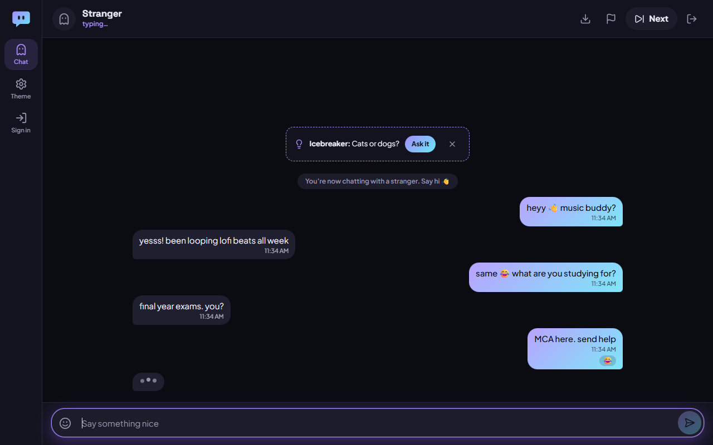

## ✨ Features

**Stranger chat (everyone)**
- One tap to match with a random person. No login wall.
- **Interest tags:** matched with someone who shares one for a few seconds, then with anyone
- A live **"N online"** count, a **typing indicator** and an **icebreaker** question when you connect
- **Reactions** on messages (❤️ 😂 😮 😢 👍 🔥) and **Save chat** as a text file
- **Esc Esc** to skip, Enter to send, and a sound when you're matched

**Safety**
- **Report** (spam, harassment, sexual content, under 18, other) also skips the chat
- 3 reports from different people in 24 hours → a **24-hour ban** (account, device and IP)
- Bad-word filter, and links from anonymous users are removed
- A warning before you send something that looks like a phone number or email
- Rate limits on messages, on Next, and on login/signup
- An 18+ and rules checkbox before the first chat

**Anonymous vs. signed up**

| | Anonymous | Signed up |
|---|---|---|
| Stranger chats per day | 15 | Unlimited |
| Interest tags | 1 | Up to 5 |
| Gender / country filter | – | ✓ |
| Language matching | – | ✓ |
| First in the queue when busy | – | ✓ |
| Send links | – | ✓ |
| Shown to the stranger as | "Stranger" | Name, avatar, country flag |
| Add friend after a chat | – | ✓ (both must accept) |
| Friends list with history, ✓✓ read receipts, replies, reactions | – | ✓ |

**Everything else:** 5 themes (Midnight Neon, Sunset, Clean Light, Matcha, Y2K Pink), profiles with generated avatars, presence and unread badges, automatic reconnects, and a phone layout with a bottom tab bar.

## 📸 Screenshots

| Start a chat | Meet a signed-up stranger |
|---|---|
| 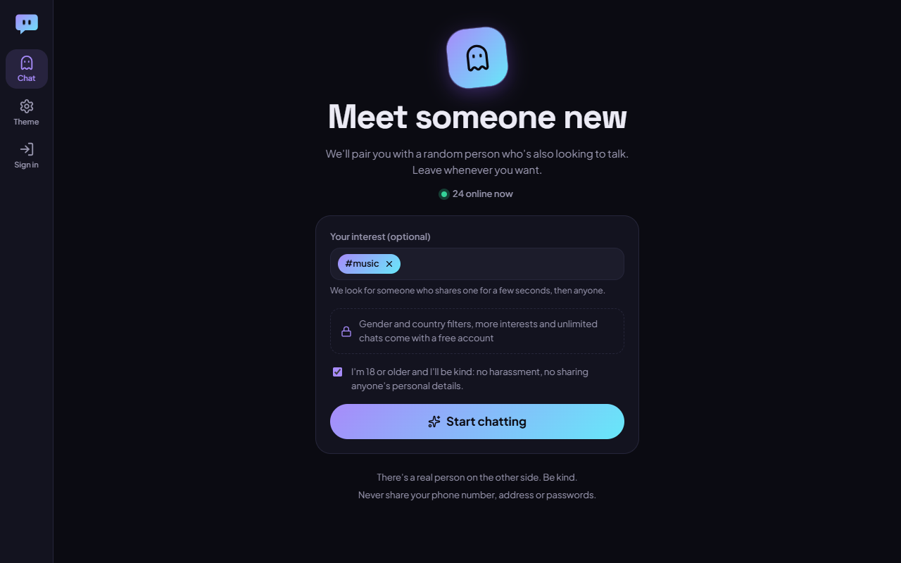 | 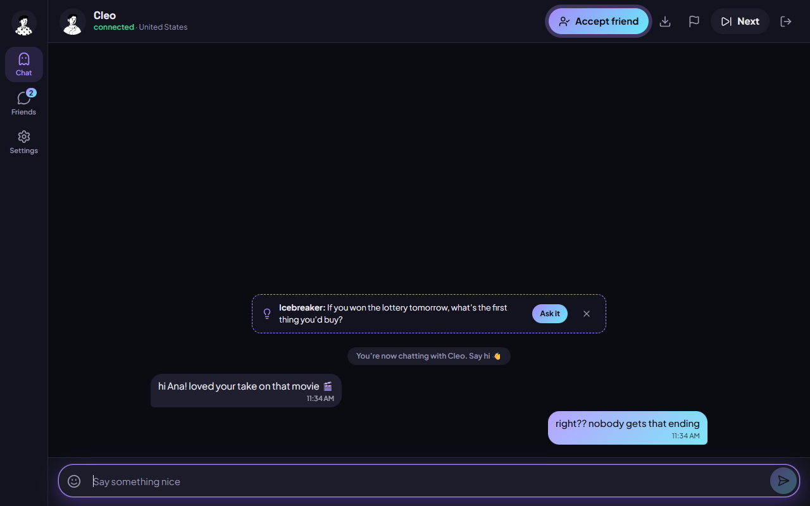 |
| **Friends you made in stranger chat** | **Sign up** |
| 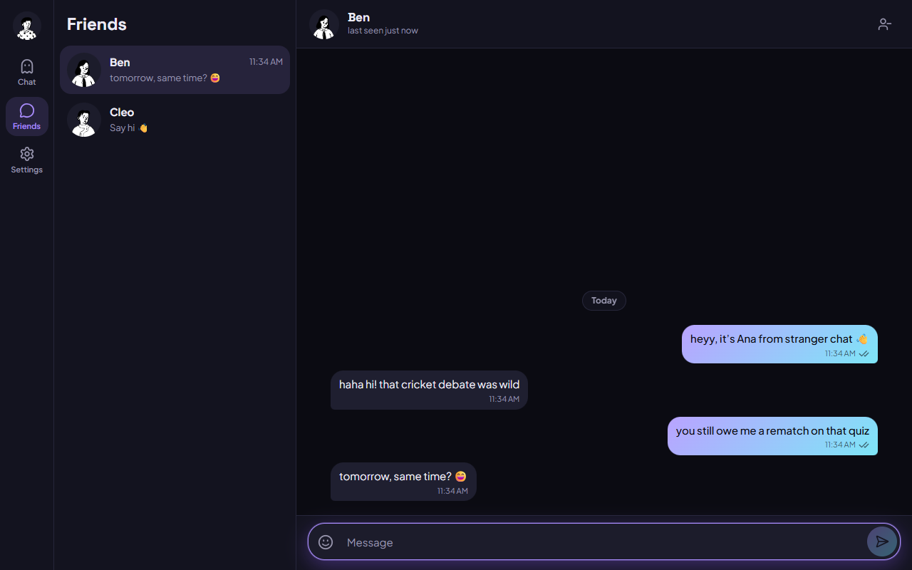 | 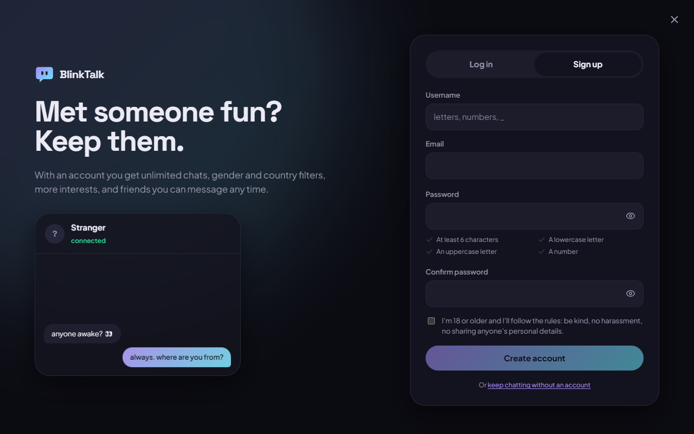 |
| **Profile and filter details** | **On your phone** |
| 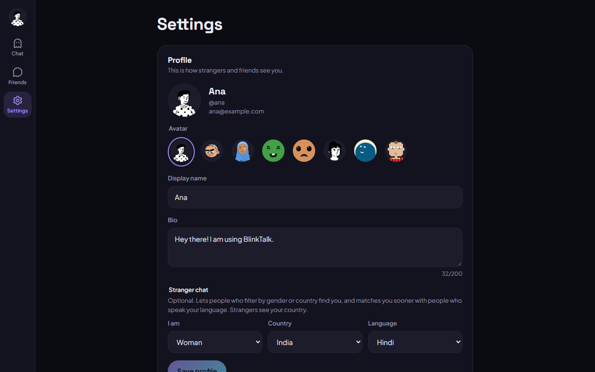 | 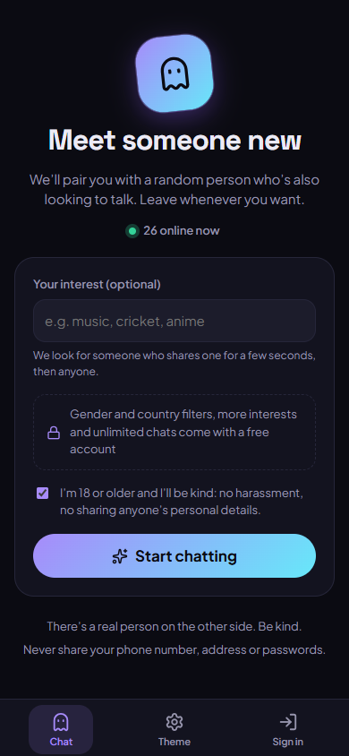 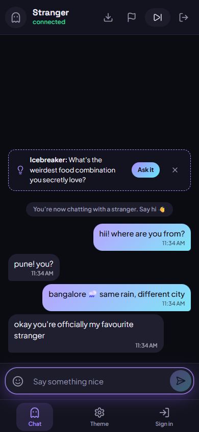 |

**Five themes:** Midnight Neon (above), Sunset, Clean Light, Matcha and Y2K Pink.

| Sunset | Clean Light | Matcha | Y2K Pink |
|---|---|---|---|
| 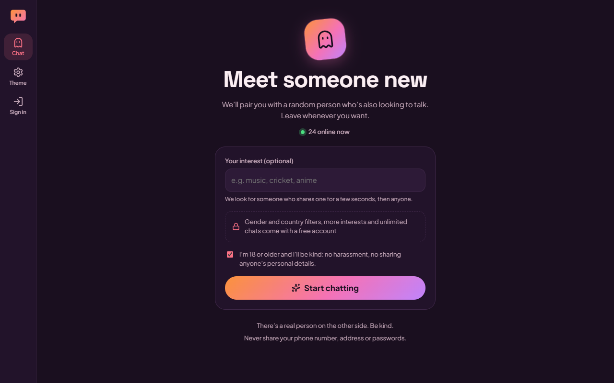 | 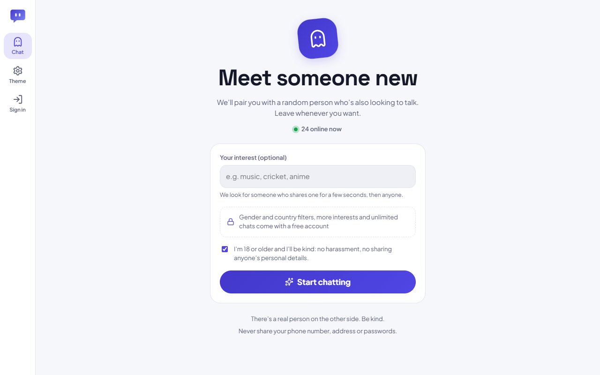 | 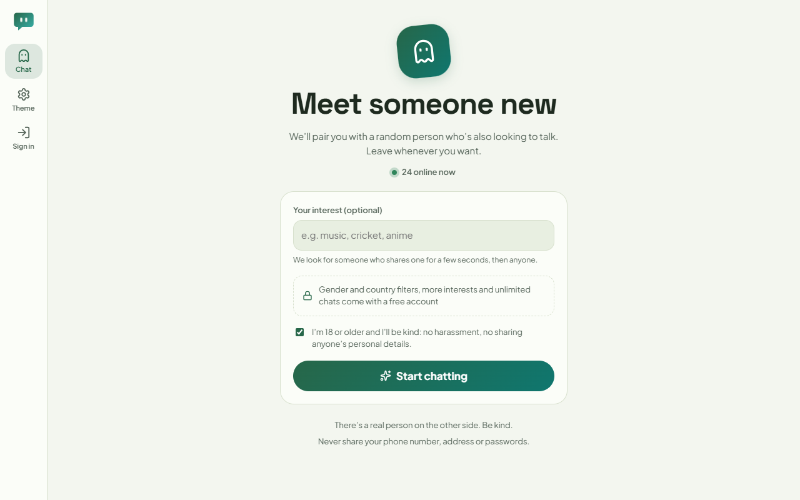 | 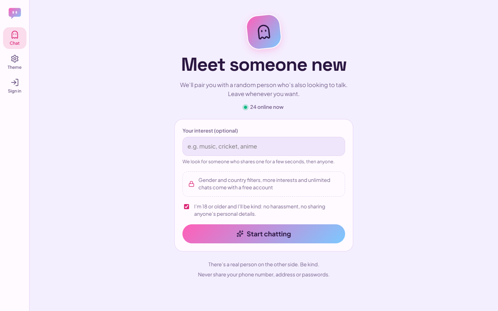 |

## 🛠️ Tech Stack

| Part | Tech |
|---|---|
| Frontend | React 19, Vite, CSS Modules + CSS variables for themes, Socket.IO client |
| Backend | Node.js, Express, Socket.IO |
| Database | MongoDB with Mongoose |
| Auth | JWT (also used to authenticate the socket connection) |
| Tests | `node:test` + in-memory MongoDB for the backend, Vitest for the frontend |

## 🚀 Getting Started

### Prerequisites
- Node.js **20.19 or newer**
- MongoDB, either installed locally or a free [MongoDB Atlas](https://www.mongodb.com/cloud/atlas) cluster

### Setup

```bash
git clone https://github.com/devKiNGCRiC/blinktalk.git
cd blinktalk
npm install                 # backend dependencies
npm install --prefix client # frontend dependencies
cp .env.example .env        # then set MONGODB_URI and JWT_SECRET (see below)
```

### Environment variables

| Variable | Default | What it does |
|---|---|---|
| `MONGODB_URI` | `mongodb://localhost:27017/blinktalk` | Database connection |
| `JWT_SECRET` | (required) | Signs login tokens. Use a long random string |
| `PORT` | `5000` | API + app port |
| `ANON_DAILY_LIMIT` | `15` | Stranger chats per day for anonymous users |
| `STRANGER_TAG_WAIT_MS` | `5000` | How long to look for a shared interest before matching anyone |
| `STRANGER_FILTER_WAIT_MS` | `15000` | When to ask "Widen your search?" |
| `STRANGER_SEARCH_COOLDOWN_MS` | `1500` | Minimum time between two Next presses |
| `REPORT_BAN_THRESHOLD` | `3` | Reports from different people (in 24 h) that trigger a 24 h ban |
| `AUTH_RATE_LIMIT` | `20` | Login/signup attempts per IP every 10 minutes |
| `TRUST_PROXY` | (off) | Set to `1` behind a proxy (Render, Railway, Nginx) so limits use the real IP |

### Run in development

```bash
npm run dev
```

This starts the API on http://localhost:5000 and the React app on **http://localhost:5173** (open this one). Both reload when you save a change.

### Run in production mode

```bash
npm run build   # builds the React app into client/dist
npm start       # serves the app + API on http://localhost:5000
```

## 🧪 Tests

```bash
npm test
```

This runs the backend unit and integration tests (matching, limits, reports, friends, messaging) against a throwaway in-memory MongoDB, so no database setup is needed. The first run downloads a MongoDB binary. It then runs the frontend unit tests.

## 📁 Project Structure

```
BlinkTalk/
├── backend/
│   ├── config/          # Database + JWT helpers
│   ├── controllers/     # REST API logic
│   ├── middleware/      # Auth + input validation
│   ├── models/          # Mongoose schemas (User, Message, Room, UsageCounter, Report, Ban)
│   ├── routes/          # REST endpoints
│   ├── socket/          # Real-time events for friends (messages, receipts, typing, reactions)
│   ├── stranger/        # Stranger chat: matcher, moderation, rate limits, socket handler
│   └── server.js        # Entry point, also serves client/dist
├── client/              # React + Vite app
│   └── src/
│       ├── api/         # REST calls
│       ├── context/     # Auth, socket, theme, toast and chat state
│       ├── components/  # Avatar, Composer, Modal, …
│       ├── features/    # auth, sidebar, chat (friends), stranger, settings
│       ├── lib/         # Pure helpers (formatting, grouping, themes)
│       └── styles/      # Theme variables + global styles
├── tests/               # Backend unit (tests/unit) and integration tests
└── docs/                # Design spec, plan and README screenshots
```

## 🌐 Deployment (Render + MongoDB Atlas)

1. Create a free MongoDB Atlas cluster and copy its connection string.
2. On [Render](https://render.com), create a **Web Service** from this GitHub repository:
   - **Build command:** `npm install && npm run build`
   - **Start command:** `npm start`
   - **Environment variables:** `MONGODB_URI`, `JWT_SECRET` (a long random string), `NODE_ENV=production`, `TRUST_PROXY=1`
3. Deploy. The one service serves both the API and the React app.

To generate a JWT secret:
```bash
node -e "console.log(require('crypto').randomBytes(32).toString('hex'))"
```

## 🗺️ Roadmap

See [ROADMAP.md](ROADMAP.md). Ideas for later: premium plans (filters could move there), image sharing between friends, and group rooms coming back.

## 📝 License

[MIT](LICENSE)

## 👨‍💻 Author

Created by [devKiNGCRiC](https://github.com/devKiNGCRiC), MCA student, India.
